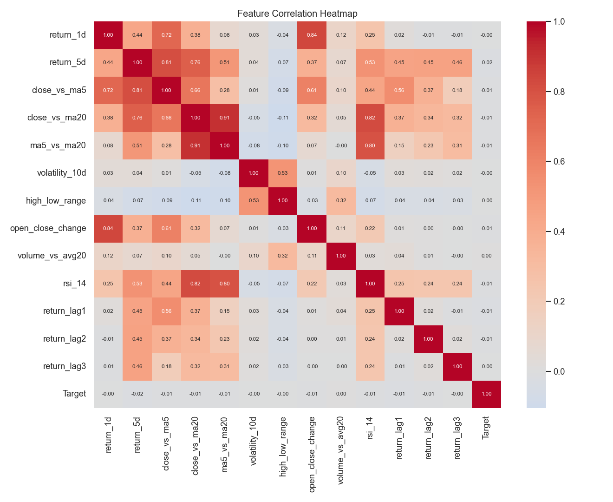
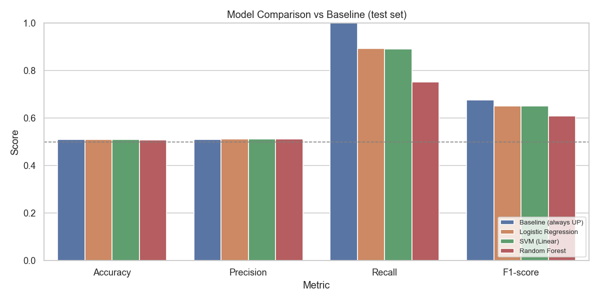
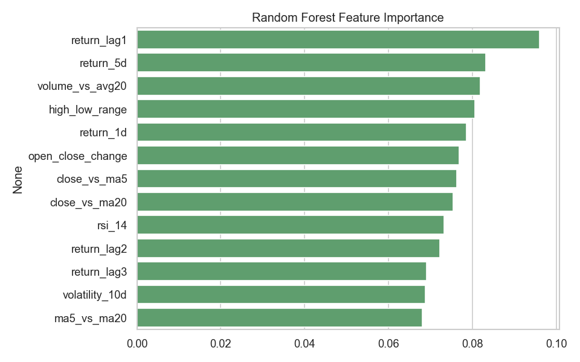

# Stock Market Trend Prediction

Predicts whether a stock's closing price will go **UP or DOWN on the next trading day**, using historical price data for **NIFTY 50** stocks. Engineers technical features with pandas, explores them with Seaborn, and compares three classification models against a simple baseline.

**Tech stack:** Python · pandas · NumPy · scikit-learn · Seaborn · Matplotlib · yfinance

## How it works

| Step | What happens |
|---|---|
| 1. Load data | Daily OHLCV data for NIFTY 50 stocks downloaded with `yfinance` (cached to `data/`), or your own CSV |
| 2. Cleaning | Parse dates, sort by stock and date, remove duplicates, missing values and invalid rows |
| 3. Feature engineering | Daily and 5-day returns, price vs 5/20-day moving averages, 10-day volatility, high–low range, open–close change, volume vs 20-day average, RSI(14), lagged returns |
| 4. Target | `1` if the next day's close is higher than today's, otherwise `0` |
| 5. EDA | Price trends, distribution of daily returns, and a feature correlation heatmap with Seaborn |
| 6. Time-based split | Train on the earliest 80% of dates, test on the latest 20%, **no shuffling** |
| 7. Model training | Logistic Regression and Linear SVM (with `StandardScaler`), Random Forest |
| 8. Evaluation | Accuracy, precision, recall, F1-score and a confusion matrix, compared with an "always predict the majority class" baseline |

## Project structure

```
stock-trend-prediction/
├── data/              # downloaded price data is cached here
├── images/            # plots and results table saved by the notebook
├── stock_trend_prediction.ipynb   # full pipeline: load → clean → features → EDA → training → evaluation
└── requirements.txt
```

## How to run

1. Install the libraries: `pip install -r requirements.txt`
2. Start Jupyter: `jupyter notebook`, open `stock_trend_prediction.ipynb`, then **Kernel → Restart & Run All**
3. The first run downloads NIFTY 50 data from 2005 (a few minutes) and caches it in `data/`. For a quicker run, set `START_DATE = "2015-01-01"` in the first code cell.

## Results

<!-- After running the notebook, copy the numbers from images/model_results.csv into this table -->

| Model | Accuracy | Precision | Recall | F1-score |
|---|---|---|---|---|
| Baseline (majority class) | | | | |
| Logistic Regression | | | | |
| SVM (Linear) | | | | |
| Random Forest | | | | |

### Feature correlation


### Model comparison


### Feature importance (Random Forest)


## Key decisions

- **Time-based split, not a random split:** shuffling would let the model train on future prices and test on the past, which inflates scores. Real predictions only ever use past data.
- **Baseline comparison:** daily stock direction is close to random, so a model is only useful if it beats "always predict UP". Accuracy around 50–55% is normal for this problem; anything much higher usually means data leakage.
- **Scaling for LR and SVM only:** both are sensitive to feature scale; Random Forest is not.
- **Ratio-based features:** features like price/moving-average are comparable across stocks with very different price levels.
